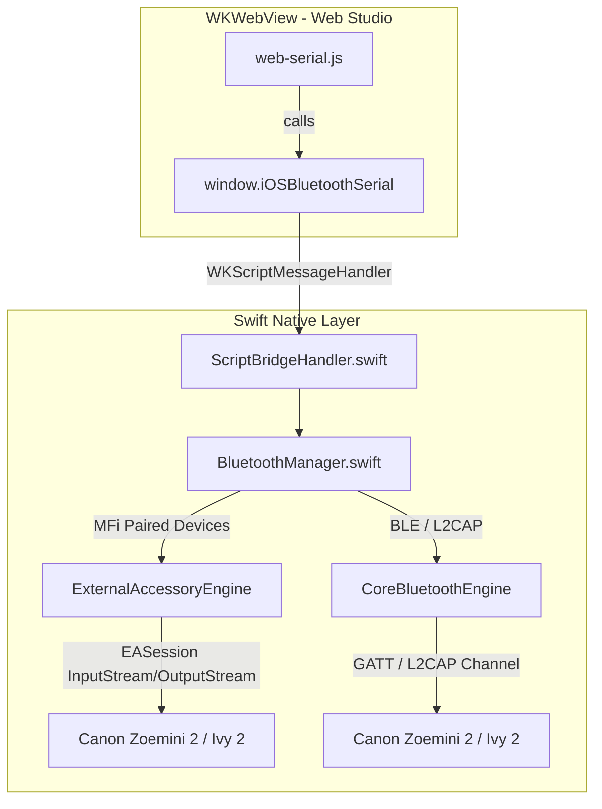

# iOS Implementation Plan: Native App Wrapper & Bluetooth Print Driver

This document outlines the architecture, technical requirements, and implementation strategy to bring **Zoemini 2 / Ivy 2 Web Print Studio** to iOS as a standalone native app and distributable package (`.ipa`), equivalent to the Android APK implementation.

---

## 1. Executive Summary & Goals

### Objectives
1. **Packaging**: Package the client-side Web Print Studio into a native iOS app (`ZoeminiPrint`) using Swift and `WKWebView`.
2. **Bluetooth Connectivity**: Solve iOS Safari's lack of Web Serial API by implementing a native Bluetooth communication bridge (`window.iOSBluetoothSerial`) mirroring the Android bridge.
3. **No Network Dependency**: Embed web assets directly in the iOS bundle, serving them locally via custom URL scheme handling (`WKURLSchemeHandler`) without remote servers.
4. **Automated CI/CD**: Create a GitHub Actions workflow (`build-ios.yml`) running on macOS runners with Xcode to build and publish unsigned `.ipa` packages and `.xcarchive` bundles on releases.
5. **Asset Synchronization**: Extend repository asset sync verification (`check-assets-sync.yml`) to ensure iOS bundled assets stay in sync with the root website.

---

## 2. Technical Comparison: Android vs. iOS

| Capability / Component | Android Implementation | iOS Target Implementation |
| :--- | :--- | :--- |
| **Runtime Container** | `WebView` + `WebViewAssetLoader` | `WKWebView` + `WKURLSchemeHandler` (`app://localhost`) |
| **Language & Tooling** | Java 17 + Gradle + Android SDK 34 | Swift 5.9+ + Xcode + `xcodebuild` |
| **BT Communication** | Classic Bluetooth RFCOMM SPP socket (`00001101-0000-1000-8000-00805f9b34fb`) | `ExternalAccessory.framework` (`EASession`) + `CoreBluetooth.framework` (BLE L2CAP/GATT fallback) |
| **Web-to-Native Bridge** | `@JavascriptInterface` (`window.AndroidBluetoothSerial`) | `WKScriptMessageHandler` + injected Promise-based `window.iOSBluetoothSerial` shim |
| **CI Build System** | `ubuntu-latest` running `./gradlew assembleRelease` | `macos-14` running `xcodebuild archive` + `.ipa` packaging |
| **Distribution Format** | `.apk` (Debug & Release) | `.ipa` (unsigned for Sideloadly/AltStore/TrollStore) & `.xcarchive` |

---

## 3. iOS Bluetooth Architecture & Constraints

### 3.1 Bluetooth Classic vs. CoreBluetooth on iOS
Unlike Android or desktop Chromium, iOS imposes specific constraints on Bluetooth:

1. **Bluetooth Classic (RFCOMM / SPP) via `ExternalAccessory.framework`**:
   - The Canon Zoemini 2 (PV-223) / Ivy 2 pairs as a Classic Bluetooth accessory in iOS Settings.
   - On iOS, Bluetooth Classic accessories communicate through Apple's MFi (Made for iPhone) subsystem via `ExternalAccessory.framework`.
   - Paired and connected devices appear under `EAAccessoryManager.shared().connectedAccessories`.
   - Data transfer uses an `EASession` created with the device's supported protocol string (e.g. `jp.co.canon.icp`, `com.canon.icp`, or standard SPP profile).
   - `EASession` provides standard `InputStream` and `OutputStream` streams, which match the byte-stream requirements of the Canon packet protocol.

2. **CoreBluetooth (BLE) Fallback / Discovery**:
   - If the printer exposes a BLE GATT service or BLE L2CAP credit-based connection-oriented channel (CoC), `CoreBluetooth` (`CBCentralManager`, `CBPeripheral`) can establish a raw binary stream without requiring MFi accessory protocols.
   - CoreBluetooth is also useful for accessory discovery or status checking.

### 3.2 Hybrid Architecture Design
To guarantee reliable connectivity:
- **Primary Engine (`ExternalAccessoryEngine`)**:
  - Monitors `EAAccessoryDidConnect` and `EAAccessoryDidDisconnect` notifications.
  - Queries `EAAccessoryManager.shared().connectedAccessories` for accessories matching `Canon`, `Zoemini`, `Ivy`, or `PV-223`.
  - Opens `EASession` for the matching protocol and manages background reading/writing via `StreamDelegate`.
- **Secondary Engine (`CoreBluetoothEngine`)**:
  - Connects to the peripheral if discovered via BLE service UUIDs.



---

## 4. WebKit Container & Native Bridge

### 4.1 Asset Serving via `WKURLSchemeHandler`
Loading web code from `file://` inside `WKWebView` causes severe limitations:
- Cross-origin restrictions prevent ES6 module imports (`import { ... } from './protocol/...'`).
- Service Workers and modern storage APIs are disabled.

**Solution: `LocalAssetSchemeHandler`**
Register a custom scheme handler (e.g., `app://localhost`) in `WKWebViewConfiguration`:
- Intercepts requests to `app://localhost/*`.
- Resolves files against `Bundle.main.resourcePath + "/Assets/"`.
- Returns proper MIME types (`text/html`, `application/javascript`, `text/css`, `image/png`, `application/json`).
- Enables full ES6 module support and secure-context behavior.

### 4.2 JavaScript Bridge API Specification
To keep `js/transport/web-serial.js` clean and uniform across Android, iOS, and Web Serial, `window.iOSBluetoothSerial` provides Promise-based methods matching the Android bridge semantics:

```typescript
interface IOSBluetoothSerial {
  isAvailable(): Promise<boolean>;
  getBondedDevices(): Promise<Array<{ name: string; address: string }>>;
  connect(addressOrId: string): Promise<string>; // Returns "OK" or error message
  writeBase64(base64Data: string): Promise<string>; // Returns "OK" or error message
  readBase64(byteCount: number, timeoutMs: number): Promise<string>; // Returns base64 string or "ERR:..."
  isConnected(): Promise<boolean>;
  disconnect(): Promise<void>;
}
```

### 4.3 Bidirectional Bridge Flow
1. **Swift Injection**: In `ViewController.swift`, inject a lightweight JS helper at `atDocumentStart` that registers `window.iOSBluetoothSerial`.
2. **Call Dispatch**: When JS calls `window.iOSBluetoothSerial.readBase64(34, 5000)`, it generates a unique callback ID and posts a message via `window.webkit.messageHandlers.iosBluetoothBridge.postMessage({ id, method, args })`.
3. **Native Execution**: Swift receives the call on a serial background worker, executes the stream operation, and dispatches the result back via:
   ```swift
   webView.evaluateJavaScript("window.__iosBluetoothCallback('\(callId)', \(resultJson), null)")
   ```

---

## 5. Directory & File Structure

```
zoemini-ivy2-print/
├── android/                             # Existing Android project
├── ios/                                 # New iOS project
│   ├── ZoeminiPrint.xcodeproj/          # Xcode project configuration
│   │   └── project.pbxproj
│   ├── ZoeminiPrint/
│   │   ├── Info.plist                   # Permissions & MFi protocols
│   │   ├── AppDelegate.swift            # App lifecycle
│   │   ├── SceneDelegate.swift          # Window & Scene management
│   │   ├── ViewController.swift         # WKWebView setup & URL scheme routing
│   │   ├── Bridge/
│   │   │   ├── BluetoothManager.swift        # Unified BT interface
│   │   │   ├── ExternalAccessoryEngine.swift # Classic BT EASession implementation
│   │   │   ├── CoreBluetoothEngine.swift     # BLE fallback implementation
│   │   │   └── LocalAssetSchemeHandler.swift # WKURLSchemeHandler for bundled assets
│   │   ├── Assets/                      # Synced from root (index.html, js, css, etc.)
│   │   └── Resources/
│   │       ├── Assets.xcassets          # AppIcon & LaunchScreen
│   │       └── LaunchScreen.storyboard
├── js/
│   └── transport/
│       └── web-serial.js                # Updated to check window.iOSBluetoothSerial
├── .github/
│   └── workflows/
│       ├── build-apk.yml                # Existing Android CI
│       ├── build-ios.yml                # New iOS CI workflow
│       └── check-assets-sync.yml        # Updated to check both Android and iOS assets
└── PLAN_iOS.md                          # This document
```

---

## 6. Permissions & Info.plist Configuration

The `Info.plist` must declare Bluetooth usage and accessory protocols:

```xml
<?xml version="1.0" encoding="UTF-8"?>
<!DOCTYPE plist PUBLIC "-//Apple//DTD PLIST 1.0//EN" "http://www.apple.com/DTDs/PropertyList-1.0.dtd">
<plist version="1.0">
<dict>
    <key>CFBundleIdentifier</key>
    <string>com.michaelschuldes.zoemini-ivy2-print</string>
    <key>CFBundleShortVersionString</key>
    <string>1.0.0</string>
    <key>CFBundleVersion</key>
    <string>1</string>
    <key>LSRequiresIPhoneOS</key>
    <true/>

    <!-- Bluetooth Permissions -->
    <key>NSBluetoothAlwaysUsageDescription</key>
    <string>Bluetooth is required to connect and print to your Canon Zoemini 2 / Ivy 2 printer.</string>
    <key>NSBluetoothPeripheralUsageDescription</key>
    <string>Bluetooth is required to connect and print to your Canon Zoemini 2 / Ivy 2 printer.</string>

    <!-- MFi Accessory Protocols -->
    <key>UISupportedExternalAccessoryProtocols</key>
    <array>
        <string>jp.co.canon.icp</string>
        <string>com.canon.icp</string>
    </array>

    <!-- Background Modes (Optional, for uninterrupted prints) -->
    <key>UIBackgroundModes</key>
    <array>
        <string>external-accessory</string>
        <string>bluetooth-central</string>
    </array>
</dict>
</plist>
```

---

## 7. CI/CD: GitHub Actions Workflow (`build-ios.yml`)

The workflow compiles the Swift project on a macOS runner and packages an unsigned `.ipa` and `.xcarchive` for distribution (sideloadable via AltStore, Sideloadly, TrollStore, or personal free Apple Developer accounts).

### Workflow Specification

```yaml
name: Build iOS App

on:
  push:
    branches: [ main ]
    tags:
      - 'v*'
  pull_request:
    branches: [ main ]
  release:
    types: [ published, created ]
  workflow_dispatch:

permissions:
  contents: write

jobs:
  build:
    name: Build iOS IPA
    runs-on: macos-14

    steps:
      - name: Checkout Repository
        uses: actions/checkout@v5

      - name: Select Xcode Version
        run: sudo xcode-select -s /Applications/Xcode_15.4.app

      - name: Sync Web Assets to iOS Project
        run: |
          mkdir -p ios/ZoeminiPrint/Assets
          cp -r index.html manifest.json sw.js css js icons ios/ZoeminiPrint/Assets/

      - name: Build Archive (Unsigned)
        run: |
          cd ios
          xcodebuild archive \
            -project ZoeminiPrint.xcodeproj \
            -scheme ZoeminiPrint \
            -configuration Release \
            -destination 'generic/platform=iOS' \
            -archivePath build/ZoeminiPrint.xcarchive \
            CODE_SIGNING_ALLOWED=NO \
            CODE_SIGNING_REQUIRED=NO \
            CODE_SIGN_IDENTITY=""

      - name: Package Unsigned IPA
        run: |
          cd ios
          mkdir -p build/Payload
          cp -r build/ZoeminiPrint.xcarchive/Products/Applications/ZoeminiPrint.app build/Payload/
          cd build
          zip -r ZoeminiPrint-unsigned.ipa Payload
          cd ..

      - name: Upload IPA Artifact
        uses: actions/upload-artifact@v6
        with:
          name: ZoeminiPrint-unsigned-ipa
          path: ios/build/ZoeminiPrint-unsigned.ipa
          retention-days: 30

      - name: Upload Archive Artifact
        uses: actions/upload-artifact@v6
        with:
          name: ZoeminiPrint-xcarchive
          path: ios/build/ZoeminiPrint.xcarchive
          retention-days: 30

      - name: Upload IPA to GitHub Release
        if: github.event_name == 'release' || startsWith(github.ref, 'refs/tags/v')
        uses: softprops/action-gh-release@v3
        with:
          files: |
            ios/build/ZoeminiPrint-unsigned.ipa
        env:
          GITHUB_TOKEN: ${{ secrets.GITHUB_TOKEN }}
```

---

## 8. Asset Synchronization Pipeline

Update `.github/workflows/check-assets-sync.yml` to verify that both the Android assets (`android/app/src/main/assets/`) and iOS assets (`ios/ZoeminiPrint/Assets/`) are identical to the website root:

```bash
# Synchronization command for developers:
cp -r index.html manifest.json sw.js css js icons android/app/src/main/assets/
cp -r index.html manifest.json sw.js css js icons ios/ZoeminiPrint/Assets/
```

The CI check will fail if any file in `css/`, `js/`, `icons/`, or the root HTML/manifest differs between the web version and either mobile platform folder.

---

## 9. Implementation Phases & Milestones

### Phase 1: Native Container & Asset Handler
- Create `ios/` folder structure and Xcode project skeleton (`ZoeminiPrint.xcodeproj`).
- Implement `LocalAssetSchemeHandler.swift` to serve local assets under `app://localhost`.
- Configure `WKWebView` in `ViewController.swift` and verify that the UI renders identically to Safari / Chrome.

### Phase 2: Web-Serial JS Adaptation & Bridge Protocol
- Implement `ScriptBridgeHandler.swift` with message dispatching.
- Inject JS shim for `window.iOSBluetoothSerial`.
- Update `js/transport/web-serial.js` to recognize `window.iOSBluetoothSerial` seamlessly alongside `window.AndroidBluetoothSerial` and Web Serial API.

### Phase 3: Bluetooth Communication Engines
- Implement `ExternalAccessoryEngine.swift` using `EAAccessoryManager` and `EASession`.
- Implement `CoreBluetoothEngine.swift` as secondary/fallback transport.
- Implement packet buffer management and exact-byte read timeouts matching `readBase64(byteCount, timeoutMs)`.

### Phase 4: CI/CD & Synchronization
- Create `.github/workflows/build-ios.yml`.
- Update `.github/workflows/check-assets-sync.yml` to validate `ios/ZoeminiPrint/Assets`.
- Test headless archive creation and artifact packaging.

### Phase 5: Device Verification & Validation
- Sideload IPA onto physical iOS device (iPhone/iPad running iOS 15+).
- Pair Canon Zoemini 2 via iOS Settings.
- Perform end-to-end print test (session initiation, status query, chunked image payload transfer, print finish).
